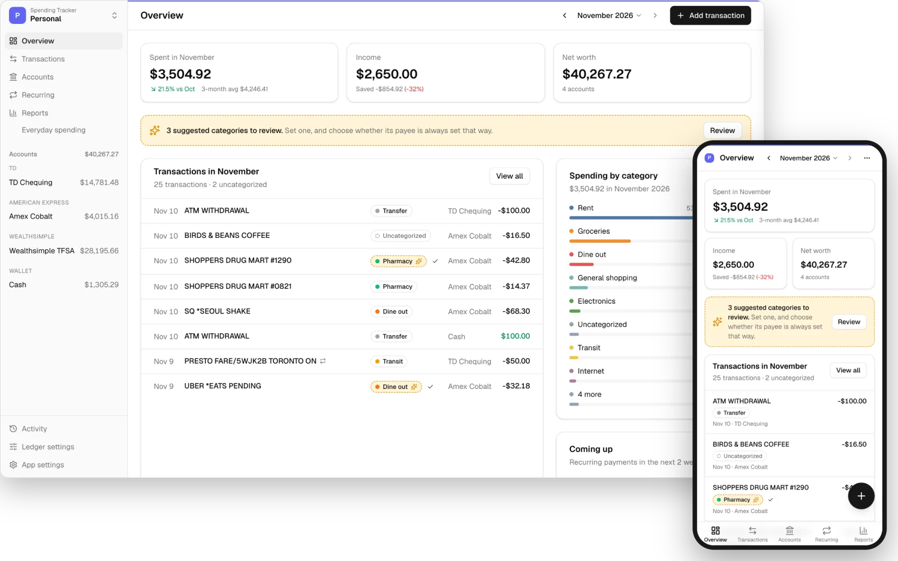
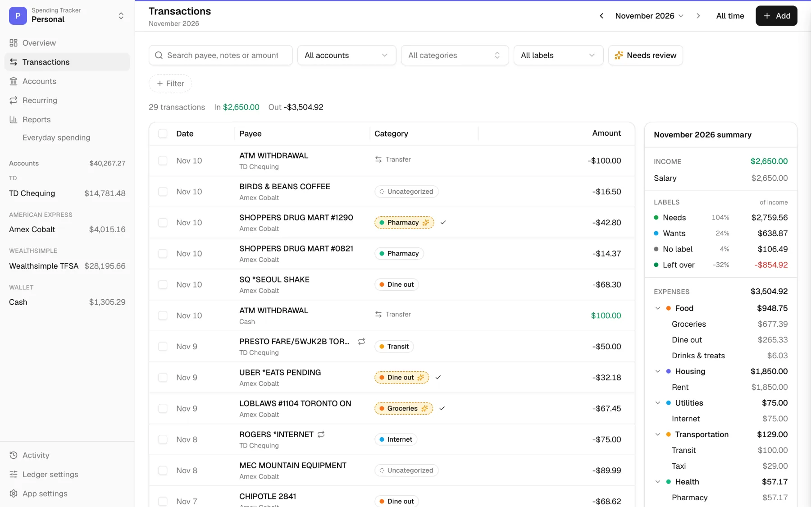
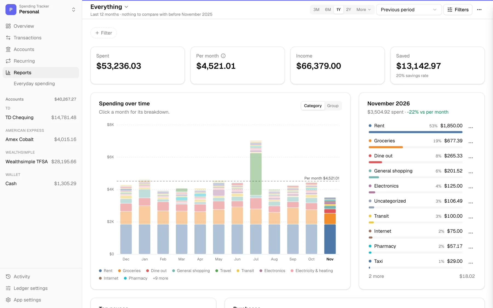
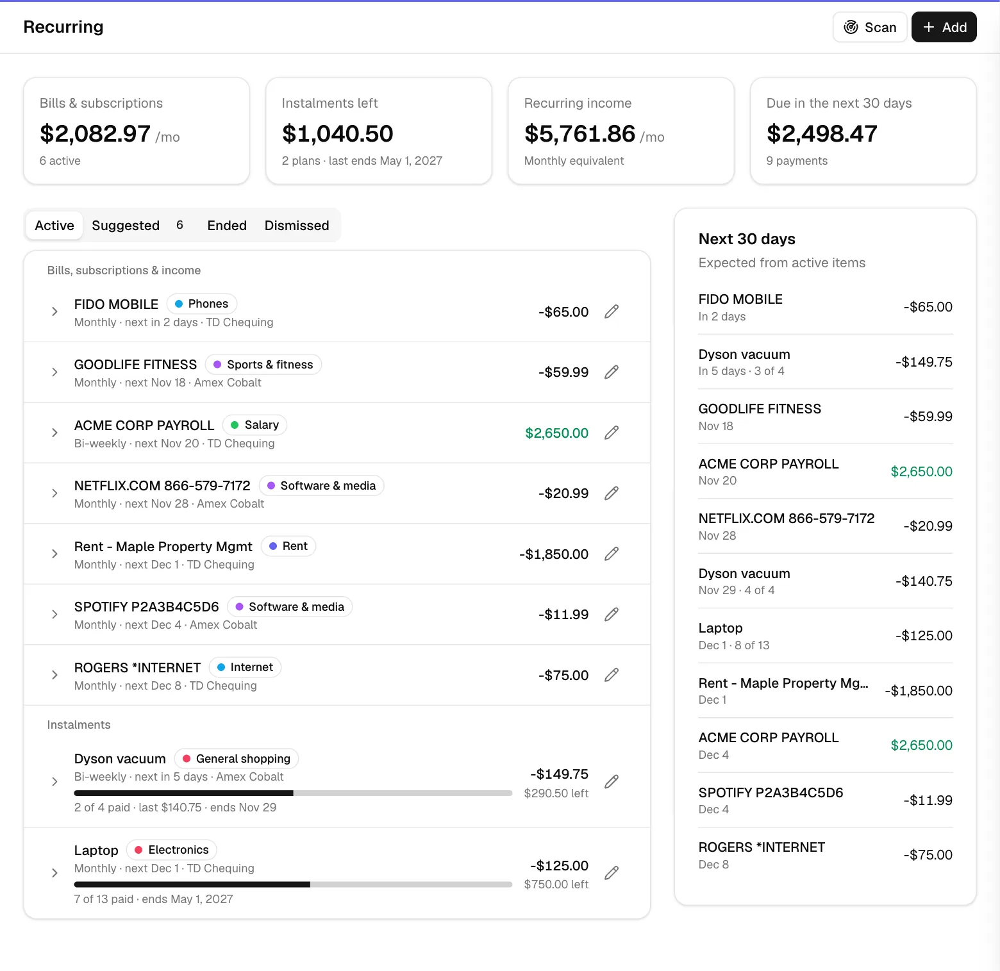
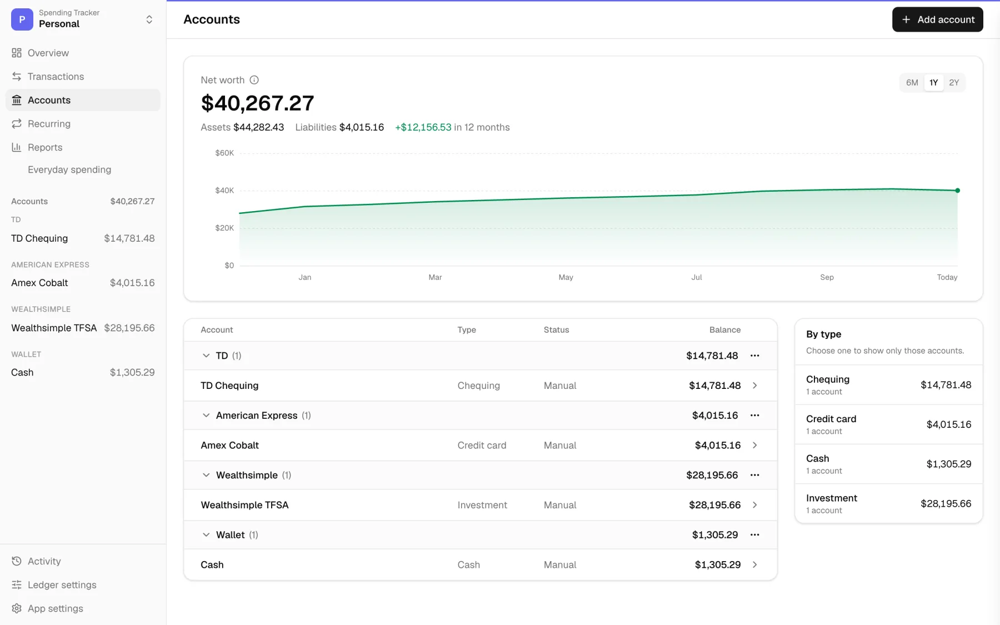
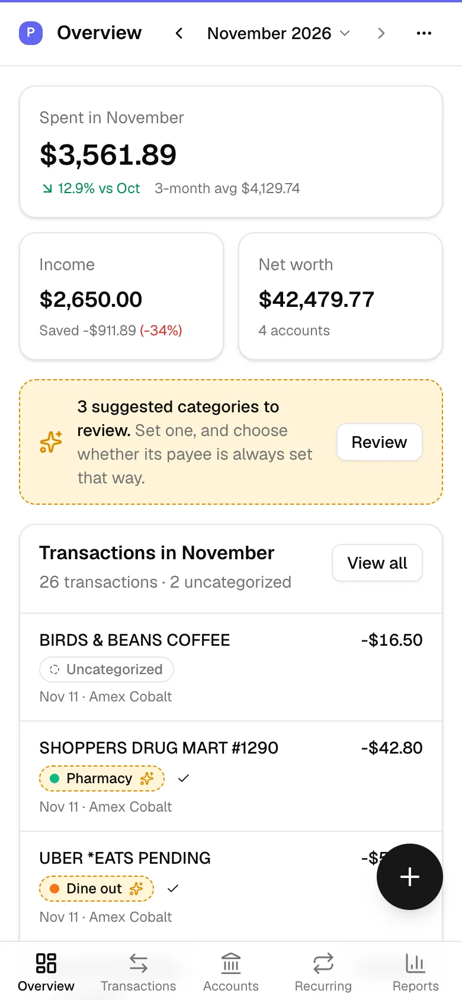
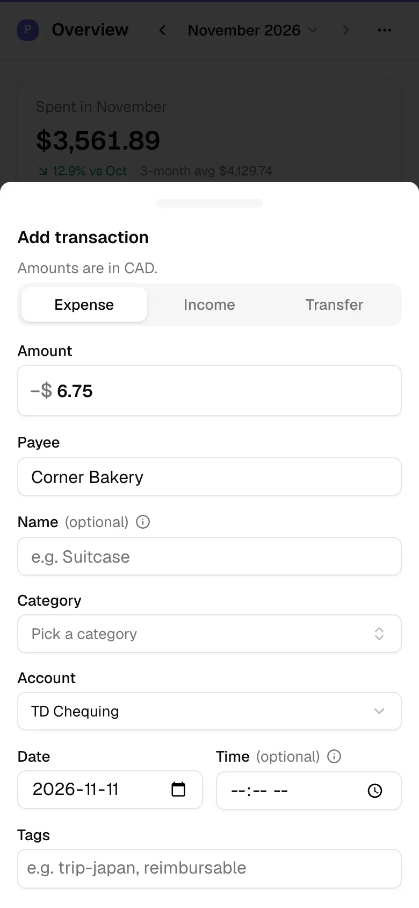

<div align="center">


# Chipmunk Money

**Your money, on your own computer.** A spending tracker that syncs your banks, learns your categories,<br>and lets your AI assistant read your books, without your data leaving home.

[Get started](#get-started) · [Features](#features) · [Docs](#documentation) · [Security](docs/security.md)

[](https://github.com/stevenwdhu/chipmunk-money/actions/workflows/ci.yml) [](LICENSE)

</div>

<picture>
  <source media="(prefers-color-scheme: dark)" srcset="docs/images/hero-dark.webp">
  
</picture>

Chipmunk is a personal finance app you host yourself, inspired by [Lunch Money](https://lunchmoney.app). It brings in your transactions from your banks or a CSV, suggests a category for each one from how you've filed things before, and shows where the money went: by month, by category, by payee. Bills, subscriptions and instalment plans are found for you, so you know what's coming.

It runs as one small server, in Docker or with Node.js, on a home server, a NAS or the laptop you're reading this on. Each set of books is a single SQLite file you own. It works on your phone too, as an app you add to your home screen.

> [!WARNING]
> There's no login yet. Anyone who can reach the port is treated as you, so keep it on your own machine, or put it behind something that signs people in, like [Tailscale Serve](https://tailscale.com/kb/1312/serve). [Security](docs/security.md) explains the options.

## Features

- **Ledgers.** Separate books for "Personal" and "Family", each with its own accounts, categories and reports.
- **Bank sync.** [SimpleFIN Bridge](https://www.simplefin.org/), [Plaid](https://plaid.com) or Wealthsimple, side by side, on a schedule you choose. Pending charges are replaced when they post, and refunds and card payments are recognized. [More](docs/bank-sync.md)
- **Categories that learn.** Each category you pick teaches it. Tell it a payee is *always* Groceries and it never asks again. New payees can go to an AI of your choice, including one running on your own computer with [Ollama](https://ollama.com). [More](docs/ai.md)
- **Recurring payments.** Subscriptions, bills and pay are found in your history. Instalment plans like Pay in 4 show what's left and when they end, and a plan's full price tells the app what its last payment will be when that's a different amount. You get a warning when a payment is missing or the price changed.
- **Reports.** Spending by month, category and payee, income against spending, your savings rate. Filter out the one-offs to see your everyday spending, and save a view as a report of its own.
- **Quick add on your phone.** A bottom sheet for the coffee you just bought, or press <kbd>N</kbd> on a computer. Transfers, tags, notes, search, bulk edit and undo.
- **CSV import.** It remembers each bank's columns, skips duplicates and can be undone.
- **Net worth.** Chequing, cards, cash, investments, loans and property, with their history.
- **A REST API and an MCP server.** Everything the app does, a script can do too. AI agents like Claude can answer questions about your spending and work through your review queue, each with its own key. [API](docs/api.md) · [MCP](docs/mcp.md)

All of it, in detail: [docs/features.md](docs/features.md).

## A closer look

<table>
  <tr>
    <td width="50%" valign="top">
      <picture>
        <source media="(prefers-color-scheme: dark)" srcset="docs/images/transactions-desktop-dark.webp">
        
      </picture>
      <br><b>Transactions.</b> Suggested categories wait for a tick. The summary on the side follows your filters.
    </td>
    <td width="50%" valign="top">
      <picture>
        <source media="(prefers-color-scheme: dark)" srcset="docs/images/reports-desktop-dark.webp">
        
      </picture>
      <br><b>Reports.</b> A year at a glance. Click a month for its breakdown.
    </td>
  </tr>
  <tr>
    <td width="50%" valign="top">
      <picture>
        <source media="(prefers-color-scheme: dark)" srcset="docs/images/recurring-desktop-dark.webp">
        
      </picture>
      <br><b>Recurring.</b> Bills and pay found in your history, and instalment plans counting down.
    </td>
    <td width="50%" valign="top">
      <picture>
        <source media="(prefers-color-scheme: dark)" srcset="docs/images/accounts-desktop-dark.webp">
        
      </picture>
      <br><b>Accounts.</b> Net worth over time, and every account under its bank.
    </td>
  </tr>
  <tr>
    <td width="50%" valign="top" align="center">
      <picture>
        <source media="(prefers-color-scheme: dark)" srcset="docs/images/overview-phone-dark.webp">
        
      </picture>
      <br><b>On your phone.</b> Add it to your home screen and it opens like an app.
    </td>
    <td width="50%" valign="top" align="center">
      <picture>
        <source media="(prefers-color-scheme: dark)" srcset="docs/images/quick-add-phone-dark.webp">
        
      </picture>
      <br><b>Quick add.</b> A few taps at the till, and it's filed.
    </td>
  </tr>
</table>

Screenshots show the demo data that comes with the app.

## Get started

With Docker, save this as `compose.yaml` in a folder of its own:

```yaml
services:
  chipmunk:
    image: ghcr.io/stevenwdhu/chipmunk-money:latest
    restart: unless-stopped
    ports:
      - "127.0.0.1:8787:8787"
    volumes:
      - chipmunk-data:/data
    environment:
      TZ: America/Toronto
volumes:
  chipmunk-data:
```

```bash
docker compose up -d
```

Open http://localhost:8787 and choose how to begin:

- **Explore the demo** loads 13 months of sample data to click around in.
- **Start from scratch** opens the app with your first account.
- **Restore a backup** brings back a ledger you saved before.

`:latest` is the newest release. To take only fixes, use a minor version like `:0.2`, and [CHANGELOG.md](CHANGELOG.md) says what each release changed. Your data lives in the `chipmunk-data` volume. Keep a copy of it somewhere safe, `secret.key` included, because that file unlocks your bank connections and AI keys. Updating is `docker compose pull && docker compose up -d`.

Running from source, building the image yourself, using it from your phone and backups: [docs/self-hosting.md](docs/self-hosting.md).

## Ask your books

Connect Claude, or any agent that speaks [MCP](https://modelcontextprotocol.io), and ask in plain words:

> *What did I spend on eating out last month, and how does it compare with my usual?*
>
> *Work through my review queue. Leave anything you're unsure about for me.*
>
> *Is any bill late, or charging more than it used to?*

```bash
claude mcp add --transport http chipmunk http://localhost:8787/mcp --header "Authorization: Bearer cm_…"
```

The agent works through the app's API with a key you create for it, *Read only* if you just want answers, and everything it changes shows up in **Activity** under that key's name. [docs/mcp.md](docs/mcp.md) has the setup and every tool.

## Documentation

| | |
|---|---|
| [Self-hosting](docs/self-hosting.md) | Docker, running from source, phones, updating and backups |
| [Security](docs/security.md) | Who can reach it, reverse proxies, API keys and `secret.key` |
| [Configuration](docs/configuration.md) | Every environment variable |
| [Bank sync](docs/bank-sync.md) | SimpleFIN Bridge, Plaid and Wealthsimple, and what happens on each sync |
| [Smart categories and AI](docs/ai.md) | How suggestions work, and setting up an AI provider or a local model |
| [Features](docs/features.md) | Everything the app does, in detail |
| [REST API](docs/api.md) | Keys, conventions, examples and every endpoint |
| [MCP server](docs/mcp.md) | Connecting agents, and every tool |
| [Development](docs/development.md) | Scripts, the project's layout and notes |
| [Releasing](docs/releasing.md) | Version numbers, Docker tags and how a release is made |

## Contributing

Bug reports and pull requests are welcome. [CONTRIBUTING.md](CONTRIBUTING.md) explains the setup and the demo data. Please never put real financial data in an issue, a test or a screenshot. To report a vulnerability, see [SECURITY.md](SECURITY.md).

## License

[MIT](LICENSE)
